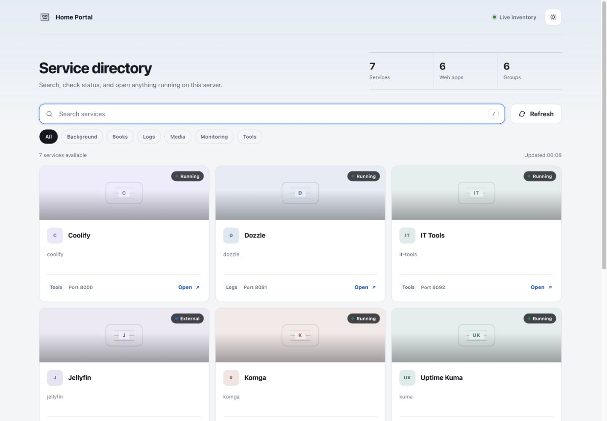

# Home Portal

Home Portal is a small, self-hosted dashboard that turns the services running on a Docker host into a searchable launch page. It discovers active containers through the Docker API, reads optional Caddy routes and external service entries, and enriches reachable services with page metadata or cached Playwright screenshots.

The interface is plain HTML, CSS, and browser JavaScript served by Express. It has no analytics, external fonts, or CDN assets.



## Features

- Live discovery of running Docker containers
- Caddy route detection for containers without published ports
- Optional external services from a local JSON file
- Page titles, favicons, and screenshot previews with TTL caches
- Search, manual refresh, automatic refresh, and theme persistence
- Clear states for background and unreachable services
- Responsive, keyboard-accessible light and dark themes

## Run locally

Requirements: Node.js 22 or a recent Docker installation.

```sh
npm ci
npm test
npm start
```

Open `http://localhost:8080`. Docker discovery expects `/var/run/docker.sock`; when running directly, make sure the current user can read that socket.

For Docker Compose, create the shared network once and start the published image. Set `IMAGE_OWNER` to the GitHub account that owns the GHCR package:

```sh
docker network create web
IMAGE_OWNER=your-github-user docker compose up -d
```

The bundled `config/services.example.json` contains only a reserved example address. Copy it to `config/services.json` for private values, then change the Compose mount to that file in a local `compose.override.yml`. The real file is ignored by Git.

## Configuration

| Variable | Default | Purpose |
| --- | --- | --- |
| `PORT` | `8080` | Internal HTTP port |
| `DOCKER_HOSTNAME` | `localhost` | Hostname used when constructing links for published Docker ports |
| `CADDYFILE_PATH` | `/config/Caddyfile` in Compose | Container path to an optional mounted Caddyfile |
| `EXTERNAL_SERVICES_PATH` | `/config/services.json` in Compose | Container path to an optional services JSON file |
| `DEPLOYED_COMMIT` | `local` in Compose | Revision reported by the health endpoint |
| `PREVIEW_TTL_MS` | `1200000` | Screenshot cache lifetime |
| `METADATA_TTL_MS` | `3600000` | Metadata cache lifetime |
| `PREVIEW_NAVIGATION_TIMEOUT_MS` | `10000` | Browser navigation timeout |
| `METADATA_TIMEOUT_MS` | `5000` | Metadata request timeout |

Set `CADDY_CONFIG_PATH` and `SERVICES_CONFIG_PATH` to private host files when starting Compose. `HOME_HOST_ENTRY` and `NAS_HOST_ENTRY` accept Compose `extra_hosts` entries for private DNS gaps. Keep the values in Coolify or an untracked local environment file.

External service entries use this shape:

```json
{
  "catalog": [
    {
      "match": ["example/dashboard"],
      "name": "Example Dashboard",
      "category": "Tools",
      "accent": "#7c5cff",
      "artwork": "generic",
      "preview": "metadata"
    }
  ],
  "services": [
    {
      "id": "example-service",
      "name": "Example Service",
      "category": "Tools",
      "url": "https://service.example.test",
      "accent": "#5b8def",
      "artwork": "generic",
      "preview": "metadata"
    }
  ]
}
```

`catalog` customizes discovered containers whose name or image contains one of its `match` strings. `services` adds endpoints that are not discoverable through the local Docker socket. Keep each `id` stable so cached metadata and previews remain associated with the same service.

## Container security

The dashboard needs read access to the Docker socket to discover containers. A read-only mount prevents filesystem writes to the socket itself, but the Docker API remains a privileged interface. Run Home Portal only on a trusted host and do not expose it to untrusted users without an authentication layer.

## Deployment

Pushes to `main` run the tests and publish `ghcr.io/<owner>/<repository>:<commit-sha>` and `:latest`. When the repository variable `COOLIFY_DEPLOY_ENABLED` is `true`, the workflow sends Coolify an application-scoped, HMAC-signed push webhook for that exact commit. Coolify supplies the commit as `SOURCE_COMMIT`, which selects the immutable image tag and is reported by the health endpoint. Pull requests run the same tests and verify that the production image builds.

See [docs/deployment.md](docs/deployment.md) for the Coolify and GitHub configuration.

## License

No license has been granted yet. Add a license before inviting third-party reuse or contributions.
